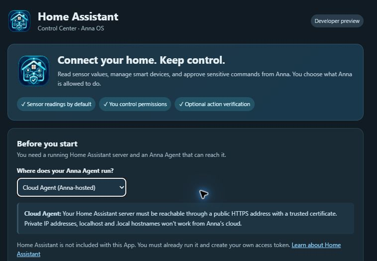
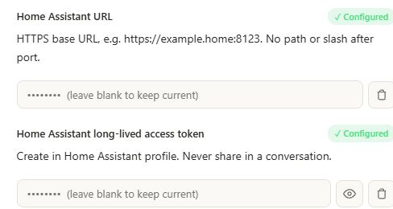
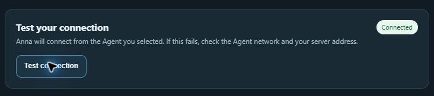
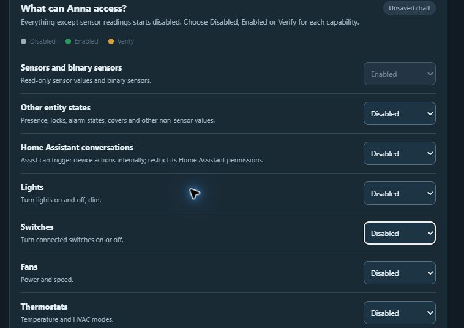
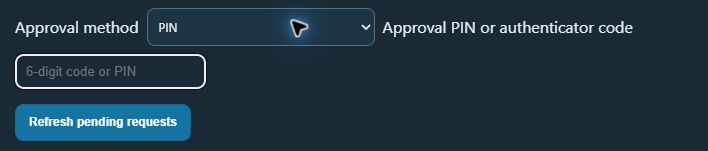

# Home Assistant Control Center for Anna

Use Control Center to connect your Home Assistant server, choose what Anna can access, and approve individual requests. After setup, use Anna chat to read sensors or control devices you have enabled.

- [Choose an Agent](#1-choose-an-agent)
- [Connect Home Assistant](#2-connect-home-assistant)
- [Set permissions](#3-set-permissions)
- [Approve a request](#4-approve-a-request)
- [Troubleshoot](#troubleshoot)

## 1. Choose an Agent

You need a running Home Assistant server and an online Anna Agent that can reach it. The Agent makes the connection to Home Assistant. Check the selected Agent in [Anna Agents](https://anna.partners/agents). The menu in Control Center explains the network requirements for each Agent type.

| Agent | Home Assistant address |
| --- | --- |
| **Cloud Agent** | A public HTTPS address with a trusted certificate. A LAN IP, `localhost`, or a `.local` name cannot be reached from Anna’s cloud. |
| **Linux x86-64 Local Agent** | An address reachable from the computer running the Agent. Use HTTPS where available. |

## 2. Connect Home Assistant

1. Install and open **Home Assistant Control Center** in Anna. Make sure the Agent you chose is online.
2. In Home Assistant, open your profile from the bottom of the sidebar. Find **Long-lived access tokens**, select **Create Token**, and give it a name such as **Anna Connector**. Copy the token when Home Assistant displays it.
3. In [Anna’s Executa Hub](https://anna.partners/executa), open **Learned**, find **Home Assistant Connector**, and select **Credentials**. Enter your **Home Assistant URL** and **Home Assistant long-lived access token**. Use the server’s base address, such as `https://ha.example.com`, without `/api` or another path. Save the form. Keep the token in this credential form and out of chat.

4. Return to Control Center and select **Test connection**. When you see **Connected**, try a read-only question in Anna chat, such as “What is the temperature from my living room sensor?” If you know the Home Assistant entity name, include it to help Anna find the right sensor.

## 3. Set permissions

After you connect, Anna can read sensors and binary sensors. Other access starts disabled. Use **Other entity states** to let Anna list or read devices such as lights and switches. Use **Lights**, **Switches**, and the other device categories to allow actions such as turning a device on or off.

| Setting | What happens |
| --- | --- |
| **Disabled** | Anna blocks requests in that category. |
| **Enabled** | Anna can run supported requests in that category. |
| **Verify** | Anna queues each request in that category for your approval. |

1. Choose the categories and settings you want. **Save choices** saves your draft in Control Center.
2. Select **Copy settings**. In the same Connector **Credentials** form, paste the settings into **Permissions policy (JSON)** and select **Save**. Leave the other credential fields blank to keep their saved values.
3. Back in Control Center, select **Check active settings**. **Matches active** confirms the Connector is using your choices.

For example, to ask “Which lights are on?”, enable **Other entity states**. To turn a light on, enable **Lights** or set it to **Verify**. Start with a device you can safely test. Home Assistant Assist, scenes, scripts, and automations can affect several devices through one request, so enable them only if you understand their effects.

## 4. Approve a request

1. For PIN approval, set a 6–12 digit **Approval and enrollment PIN** in the Connector’s **Credentials** form. For an authenticator app, use **Set up verification** in Control Center to generate a seed, then add it to your authenticator and the Connector’s **Authenticator app secret** field. Clear the seed from the Control Center view when you finish.
2. Set the relevant category to **Verify** and apply the settings as described above. Ask Anna to perform the action in chat.
3. In Control Center, go to **Identity verification** and select **Refresh pending requests**. Check the action and device. The request expires after two minutes.
4. Choose **PIN** or **Authenticator app code**, enter it in Control Center, and select **Review and verify** beside the request. If the action or device is unexpected, let the request expire. Request it again in chat if you still want to approve it after it expires.

## Troubleshoot

| What you see | What to check |
| --- | --- |
| **Not connected** | Check that the selected Agent is online and the URL is reachable from that Agent. For Cloud Agent, use a public HTTPS address with a trusted certificate. Check the URL and token in **Credentials**, then retest. |
| **Connector not deployed** | Confirm you opened the installed Control Center in Anna and the Home Assistant Connector is installed on the Agent you’re using. Check [Anna Agents](https://anna.partners/agents) for the Agent status. |
| **Anna can read sensors but cannot see my lights** | Enable **Other entity states**, apply your settings in **Credentials**, and select **Check active settings**. The **Lights** category controls actions on lights. |
| **Draft differs** | Copy the settings again, save them in **Permissions policy (JSON)**, and check active settings. |
| **The approval queue is empty** | Check that the active category is set to **Verify**, make the request in chat again, and refresh the queue within two minutes. |
| **The token no longer works** | Create a replacement in Home Assistant and save it in Anna’s Connector credentials. To disconnect Anna immediately, revoke its token in Home Assistant. |

For help, open a [GitHub issue](https://github.com/ericlmccormick/Anna-Home-Assistant-Executa/issues). Include the app version, Agent type, and the exact error message with private addresses, device names, and secrets removed.
